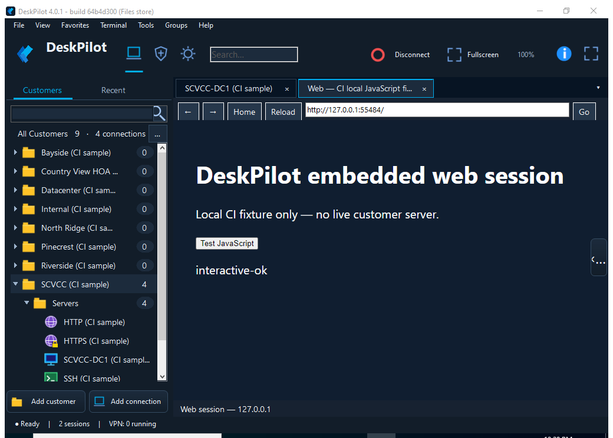
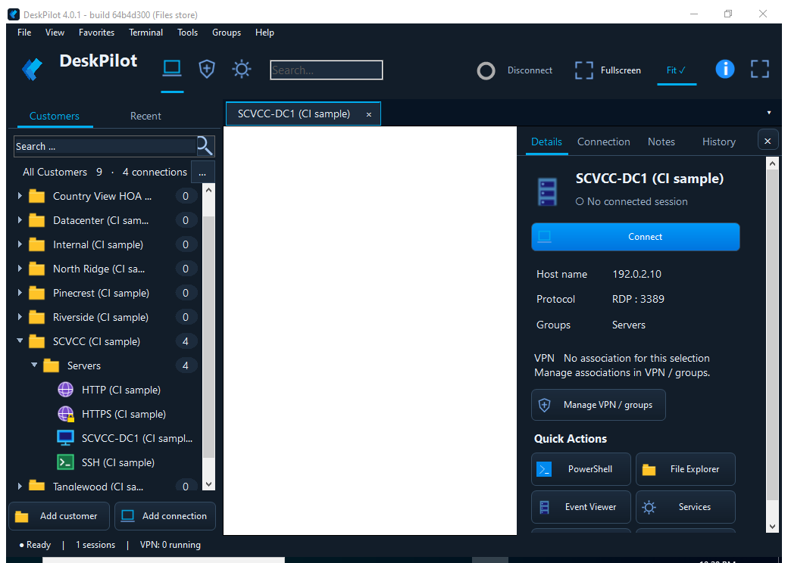
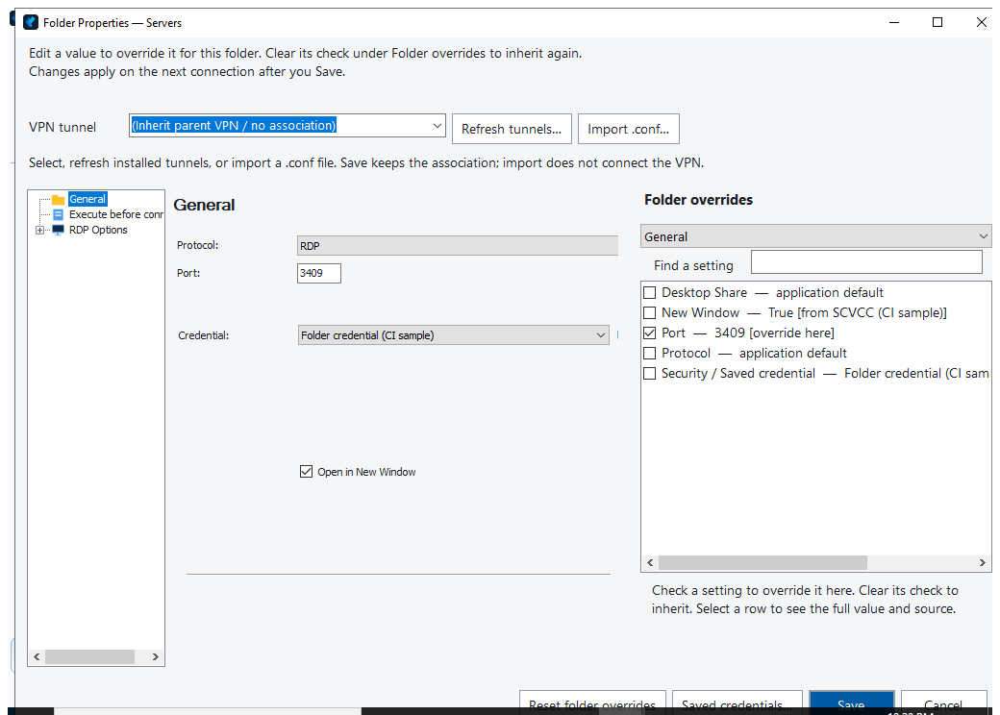

# DeskPilot

**Remote connections, organized by customer.**

DeskPilot is a free, source-available Windows connection manager based on
[Terminals](https://github.com/Terminals-Origin/Terminals). Keep RDP desktops,
SSH terminals and device web interfaces in one tabbed workspace, with customer
folders, inherited connection settings and optional WireGuard VPN associations.

[Download DeskPilot Beta](https://github.com/jon-c650/deskpilot-community/releases/download/v0.1.0-beta.4/DeskPilot-Beta-0.1.0-beta.4-Website.zip)
· [Release notes and individual downloads](https://github.com/jon-c650/deskpilot-community/releases/tag/v0.1.0-beta.4)
· [JC Electronics](https://jcelectronics.net)

*Actual beta interface with synthetic sample data and a local web test page.
These screenshots do not depict a real customer system.*

## Install the beta

Current release: **0.1.0-beta.4**, Windows 10/11 with .NET Framework 4.8.

Download the complete bundle, extract it, close running DeskPilot sessions and
run the included **Setup.exe**. Setup installs for the current Windows user.
Visual Studio, PowerShell setup scripts and DLL registration are not required.

The bundle contains Setup, its exact matching editable source ZIP, license and
third-party notices, installation/testing guidance, build identity and checksums.
Setup also installs that source ZIP in the application's **Source** folder.
Keep source and notices with redistributed copies.

This is unsigned beta software: Windows may show publisher/reputation warnings.
Retain normal backups and test your connection workflows before relying on it
for administration. Web sessions require Microsoft's WebView2 Runtime; VPN
features require official WireGuard for Windows. Ordinary Windows administrator
consent still applies to privileged VPN operations.

## Switch or recover the interface

In both layouts, choose **View → Interface on next launch → DeskPilot dark,
DeskPilot light, or Classic**, then close and reopen DeskPilot. The change applies
on the next launch; it does not restart active sessions.

On an older beta with a hidden Classic menu, close DeskPilot, open
`%LOCALAPPDATA%\DeskPilot\IsolatedPreview`, rename only `ui-mode.txt` to
`ui-mode.old`, and reopen. This resets the layout choice, leaving connection,
credential and VPN data intact. Beta 0.1.0-beta.4 restores the Classic menu at
startup even when the saved toolbar layout hid it.

## Features

- **Tabbed embedded sessions:** Microsoft RDP, PuTTY SSH and WebView2 HTTP/HTTPS.
- **Customer organization:** searchable folders, recent connections, folder
  defaults and individual endpoint overrides.
- **Protocol icons:** blue monitor for RDP, green terminal for SSH, purple globe
  for HTTP and globe with a gold lock for HTTPS. Shape and color distinguish them.
  The HTTPS icon identifies the saved protocol; it does not certify a connection's
  certificate or trust status.
- **WireGuard integration:** customer/folder tunnel associations and compatible
  configuration import through the application.
- **Flexible workspace:** dark and light themes, a stationary customer sidebar,
  hideable Details, RDP fit/fullscreen and detachable session tabs.
- **Saved settings:** credential references, notes and existing DeskPilot customer
  data remain available. Setup and uninstall preserve saved DeskPilot profiles
  and original Terminals data.

The core beta excludes legacy dial-up, packet capture/scanner utilities and old
cloud/screenshot integrations. Tools retains Options, Credentials and Open log
folder.

## Screenshots

*Distinct protocol icons in the folder list. This capture uses synthetic data
and a disconnected RDP control.*

*Folder defaults, inherited settings, overrides and the VPN picker with synthetic
test values.*

## Source and verification

This repository starts with a fresh import of the reviewed corresponding-source
package. It contains application/plugin/helper source, editable resources,
original DeskPilot artwork, project files and build instructions. It does not
import the development repository's history, old vendor binary archives, user
profiles or signing keys.

`BUILD.txt`, `SOURCE-MANIFEST.json` and `PUBLICATION.json` record the original
release identity, reviewed input hashes and source import. The exact source ZIP
for the downloadable installer is also a release asset. Product documentation and
screenshots are additional files. Those root records describe the initial import;
subsequent fixes are tracked in Git. Each installer release supplies its own exact
matching source ZIP and current manifest.

- [Build from source](docs/release/BUILD-FROM-SOURCE.md)
- [License/dependency review](docs/release/LICENSE-REVIEW.md)
- [Third-party notices](docs/release/THIRD-PARTY-NOTICES.md)
- [Installation and acceptance testing](docs/release/INSTALLER-TESTING.md)
- [Windows build and regression workflow](https://github.com/jon-c650/deskpilot-community/actions/workflows/windows-baseline.yml)

The release's automated checks cover credential/XML compatibility, disposable
SQL read/write, disconnected RDP geometry, SSH/web fixtures, VPN import safeguards,
installer lifecycle, saved-profile hashes and a separate rebuild using only the
supplied source. They do not verify authenticated live RDP/SSH servers, HTTPS
logins or a real WireGuard tunnel. Repeat those acceptance checks on Windows.

Please report bugs through [GitHub Issues](https://github.com/jon-c650/deskpilot-community/issues)
with your build ID and reproduction steps. Redact credentials, private keys and
customer information from logs and screenshots.

## License and attribution

DeskPilot retains Terminals' **Microsoft Shared Source Community License
(MS-CL, 2005)**, reproduced in [LICENSE.md](LICENSE.md), and original attribution.
New DeskPilot code uses the same project terms. Separate component licenses
remain applicable. This is a free, source-available beta, not an MIT-licensed
project; no vendor endorsement is claimed.
